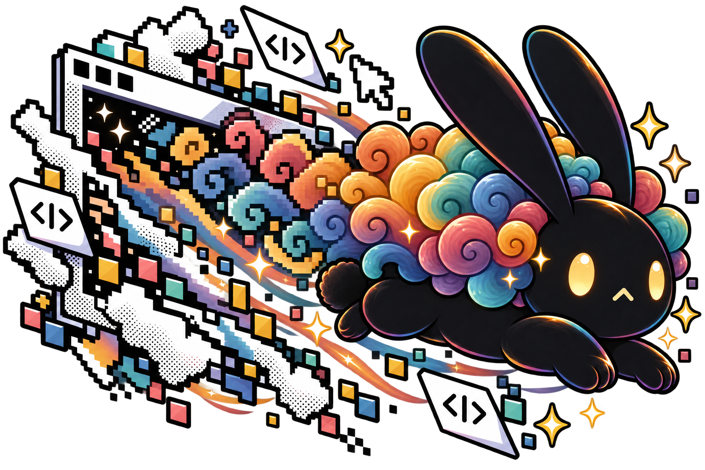
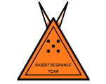
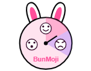
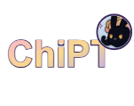
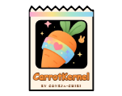

<h1 align="center">HopThorne</h1>

  

A preset for SillyTavern with 364 tools, from Emotions to Weather to Dere.

You set the basics once (tense, viewpoint, length, your model, genres) and switch on the tool groups you want. At the end of each reply the model asks for the tools the next scene needs, by name, and only those load. Tool calls fold into one clickable line in chat, so the story stays readable.

## Get it

Visit the [HopThorne website](https://coneja-chibi.github.io/HopThorne/) or download [`HopThorne v1.json`](presets/HopThorne%20v1.json).

1. In SillyTavern, import the file as a **Chat Completion preset**.
2. Turn on **Macros 2.0** (the Experimental Macro Engine).
3. When SillyTavern asks, **allow the bundled regex scripts**. That's SillyTavern's built-in Regex feature, not an extension.

That's it. No browser extension, server plugin, or installer.

## What it won't do

- **No dice of its own.** If an outcome needs a roll, it asks you for one instead of making one up.
- **No web.** Fandom and canon tools use what the model remembers, not live search.
- **No promises about the model.** It can still skip or misread a tool. Keep a continuity note before you trim chat history.

## More from Coneja-Chibi

<table align="center">
<tr><td align="center" width="25%"><a href="https://github.com/Coneja-Chibi/Hoplight"> Hoplight</a></td><td align="center" width="25%"><a href="https://github.com/Coneja-Chibi/TunnelVision"> TunnelVision</a></td><td align="center" width="25%"><a href="https://github.com/Coneja-Chibi/Rabbit-Response-Team"> Rabbit Response Team</a></td><td align="center" width="25%"><a href="https://github.com/Coneja-Chibi/BunMoji"> BunMoji</a></td></tr>
<tr><td align="center" width="25%"><a href="https://github.com/Coneja-Chibi/ChiPT"> ChiPT</a></td><td align="center" width="25%"><a href="https://github.com/Coneja-Chibi/VectHare"> VectHare</a></td><td align="center" width="25%"><a href="https://github.com/Coneja-Chibi/CarrotKernel"> CarrotKernel</a></td><td align="center" width="25%"><a href="https://coneja-chibi.github.io/HawThorne/"> HawThorne</a></td></tr>
</table>

